# altair_frameworkの使い方

altair_frameworkを実際に使うやり方について紹介します．

## 初めにGitHub上でFork＆リネームする

ブラウザで元のリポジトリのページを開きます.

[https://github.com/Altairu/altair_framework](https://github.com/Altairu/altair_framework)

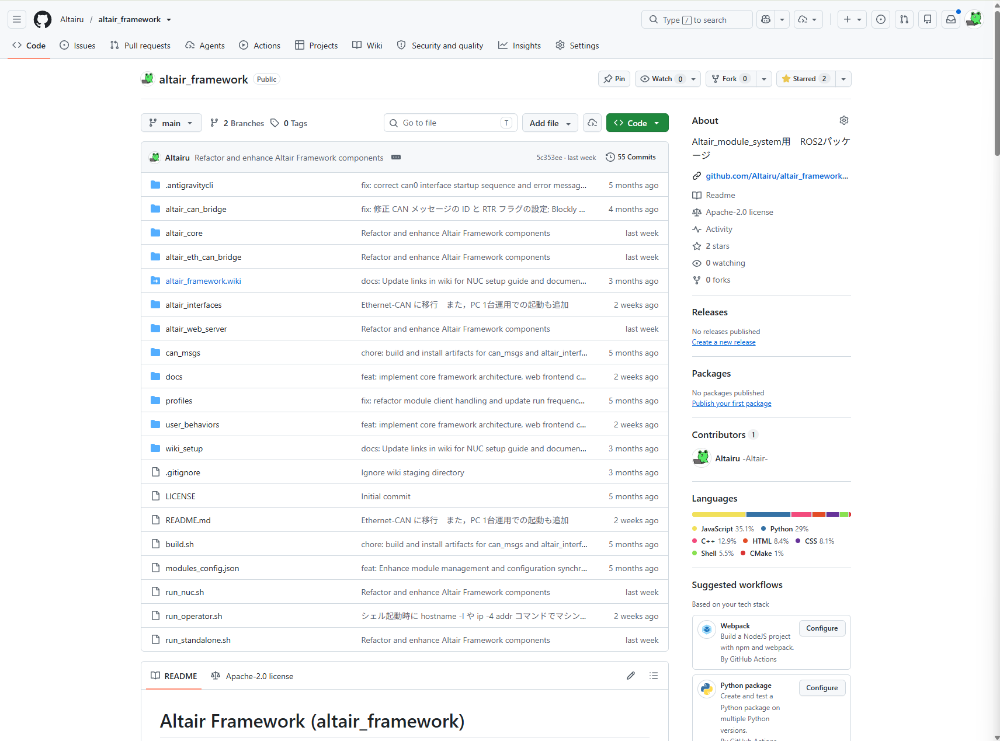

画面右上にある Fork ボタンをクリックします。


「Create a new fork」という設定画面が開くので、以下のように設定します。

Owner: SkenHub もしくは自分のアカウント　

Repository name: デフォルトで元の名前が入っているので、ここで好きな新しいリポジトリ名に書き換えます。

例えば2026年春ロボコンAチームなら
2026_HaruROBO1_altair_framework
のように

Copy the main branch only: 特に他のブランチが不要ならチェックを入れたままでOKです．

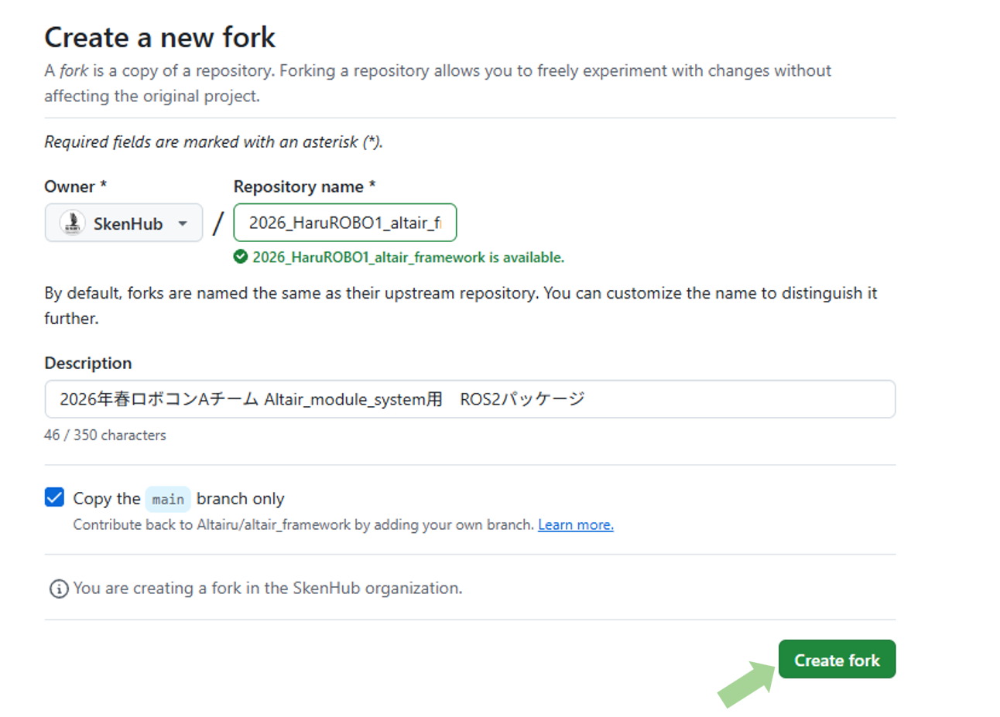

緑色の Create fork ボタンを押します．


これで、新しい名前のリポジトリが作成されます（リポジトリ名の下に小さく forked from 元の作者/元のリポジトリ と表示されます）。

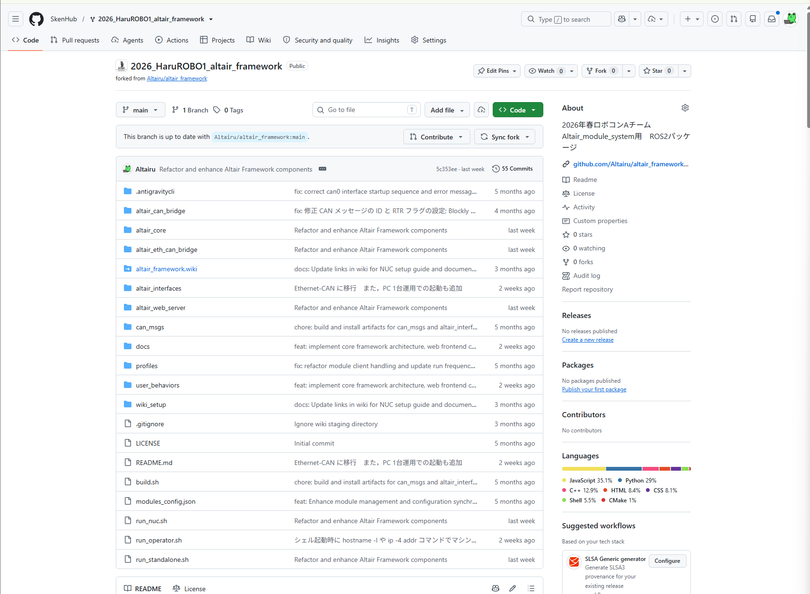


!!! info "名前変更について"
    (※もしForkした後に名前を変えたくなった場合でも、自分のリポジトリの Settings タブ ＞ 一番上の Repository name からいつでも変更できます)


## ローカルにクローンして開発を始める

自分の新しいリポジトリのページで、緑色の <> Code ボタンからURLをコピーします。

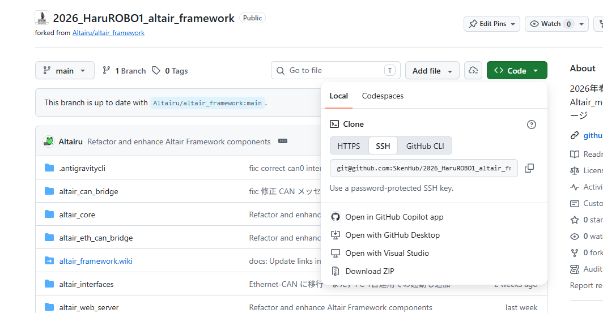

!!! warning 
    SSH設定していない場合はHTTPSでも可能ですがSSHを使用した例を以下に続けます
    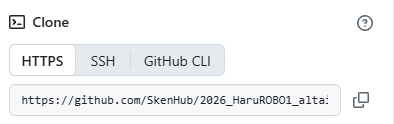

??? tip "GitHubのSSH設定について"
    GitHubでSSH設定していると楽なのでやっておきましょう．
    [GitHubのSSH設定について](https://qiita.com/ikura_ooo/items/12a6f474b1b80122212d)

### ターミナルを使う場合
ターミナルでクローンします。
```Bash
git clone https://github.com/自分のID/新しいリポジトリ名.git
cd 新しいリポジトリ名
```

先ほどの例だと
```bash
git clone git@github.com:SkenHub/2026_HaruROBO1_altair_framework.git
cd 
```

以下ログ
```
altair@Altair-P16v:~$ git clone git@github.com:SkenHub/2026_HaruROBO1_altair_framework.git
Cloning into '2026_HaruROBO1_altair_framework'...
remote: Enumerating objects: 2747, done.
remote: Counting objects: 100% (150/150), done.
remote: Compressing objects: 100% (93/93), done.
remote: Total 2747 (delta 86), reused 95 (delta 57), pack-reused 2597 (from 1)
Receiving objects: 100% (2747/2747), 4.12 MiB | 1.29 MiB/s, done.
Resolving deltas: 100% (1662/1662), done.
altair@Altair-P16v:~$ cd 2026_HaruROBO1_altair_framework/
altair@Altair-P16v:~/2026_HaruROBO1_altair_framework$
```

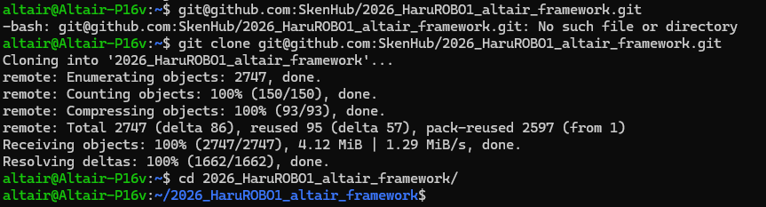

あとは普段通り、コードを編集して commit し、git push origin main するだけです。Push先は自分のForkリポジトリ（origin）になっているため、元のリポジトリが書き換わることは一切ありません。


### VScodeなどGUIを使う場合

VS Codeを開き、左側のメニューから「ソース管理」アイコン（枝分かれしたマーク）をクリックします.
「リポジトリのクローン」 ボタン（または GitHub からクローン）をクリックします.

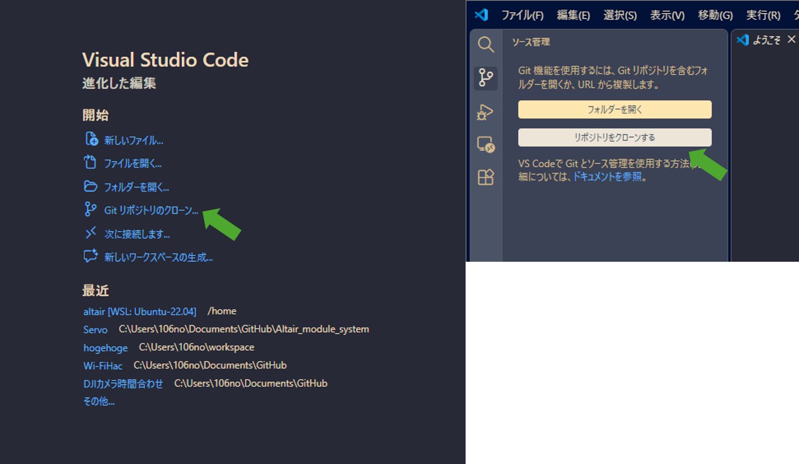

検索窓に自分のGitHubアカウントのリポジトリ一覧が出るので、先ほどForkして名前を変えた 自分のID/新しいリポジトリ名 を選択します。(※一覧に出ない場合は、ブラウザから自分のFork先リポジトリのURLをコピーして貼り付ければOKです)

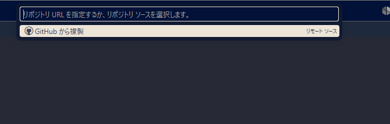

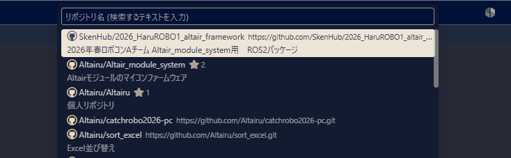

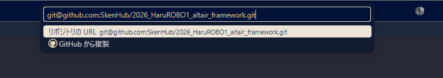


「リポジトリのクローン」 ボタン（または GitHub からクローン）をクリックします。


PC内の保存先フォルダを選択するとダウンロードが始まり、完了後に右下に表示される 「開く（Open）」 を押せば準備完了です。

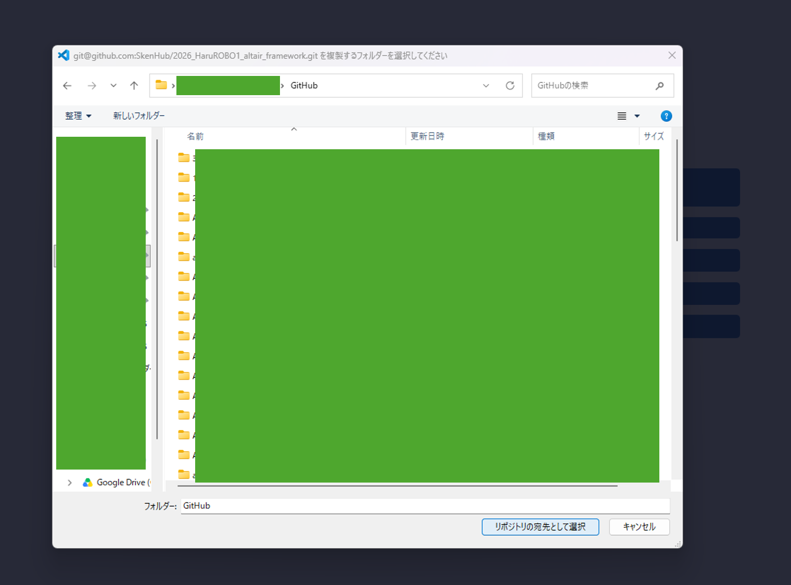

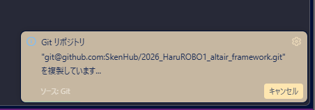

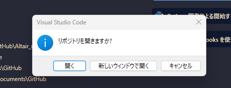

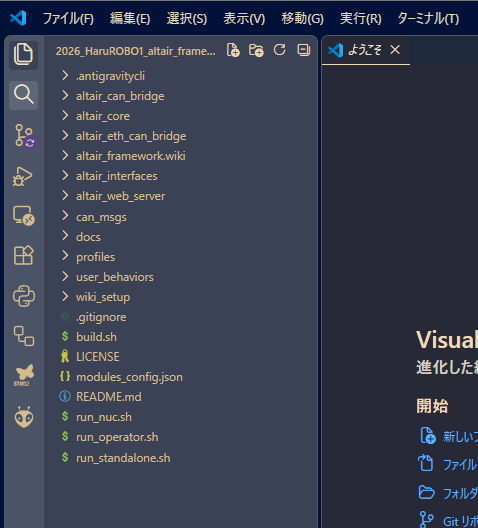

あとは普段通り、コードを編集して commit し、git push origin main するだけです。Push先は自分のForkリポジトリ（origin）になっているため、元のリポジトリが書き換わることは一切ありません。

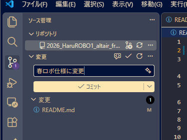

## 実際に使っていく

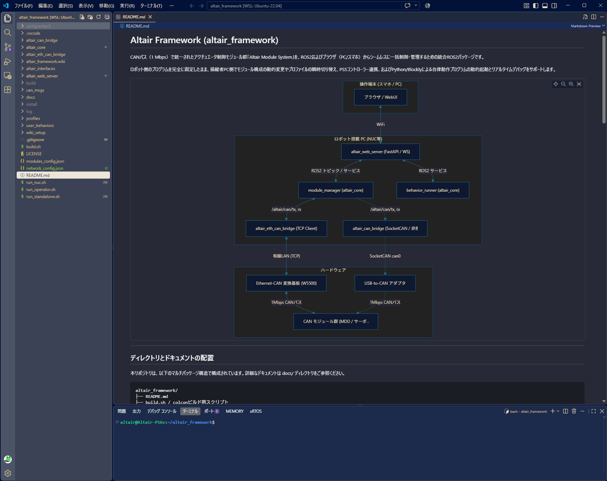

具体的な使い方についてはREADMEを読むことをお勧めする．

本パッケージは、Ubuntu 22.04 + ROS2 Humble 環境での動作を確認しています。

### 依存パッケージのインストール
物理CANフレームをROS2上で扱うための標準パッケージ can_msgs / ビルドツールをインストールします。
```bash
sudo apt update
sudo apt install ros-humble-can-msgs python3-colcon-common-extensions
```

### Python依存ライブラリのインストール
FastAPIサーバーの稼働に必要なライブラリをインストールします。
```bash
pip install fastapi uvicorn websockets
```

### リポジトリのビルド
ワークスペースのトップでビルドスクリプトを実行します。
```bash
# 実行権限の付与
chmod +x build.sh run_standalone.sh run_nuc.sh run_operator.sh
chmod +x altair_can_bridge/scripts/setup_slcan.sh

# キャッシュをクリーンして再ビルド
./build.sh --clean
```

### 起動と運用コマンド PC 1台運用（推奨：ロボット搭載PCのみで全ノードを実行）

制御ループと通信をロボット内部で完結させるため、ロボコン会場での無線トラブルに最も強い構成です。


```bash
# Ethernet-CAN を使用する場合 (推奨 / デフォルト: 192.168.2.123:5000)
./run_standalone.sh

# 従来の USB-to-CAN を使用する場合 (非推奨)
./run_standalone.sh --usb
```

起動後、同一WiFiネットワーク内のPCやスマートフォンのブラウザから、以下のURLにアクセスします。
* URL: `http://<ロボットPCのIPアドレス>:8000/`

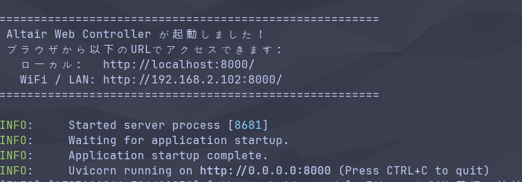

ちなみにスマートフォンやタブレットでも問題なく開くことができます

!!! warning 
    なお注意点としてPC側のIPアドレスを手動で適切に設定する必要があります。
    マイコンのIPアドレスが 192.168.2.123 でネットマスクが 255.255.255.0 の場合、PC側のIPアドレスは「ネットワーク部（192.168.2）を同じにし、ホスト部（最後の数字 123）をマイコンと被らない別の数字」に設定する必要があります。

    IPv4 メソッド: 手動 にチェック   
    
    アドレス（IPアドレス）: 192.168.2.x （x の部分は 1 から 254 までの中で、123 以外の数字。例えば 192.168.2.100 や、画像に元々入力されている 192.168.2.234 などでOKです）  
    
    ネットマスク: 255.255.255.0   
    
    ゲートウェイ:マイコンとPCをLANケーブルで1対1で直結（またはハブを介してルーターなし）している場合は、空欄またはマイコン側のIPを指定しても通信できないため、空欄のままで構いません。ネットワックス内にインターネット接続用のルーター等がある場合はそのIPアドレス（例: 192.168.2.1）を入力します。

    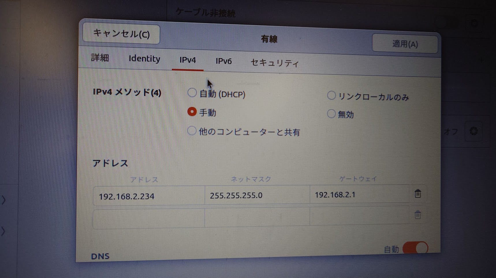

## その他ドキュメントについて

READMEまたwikiに解説も載っています

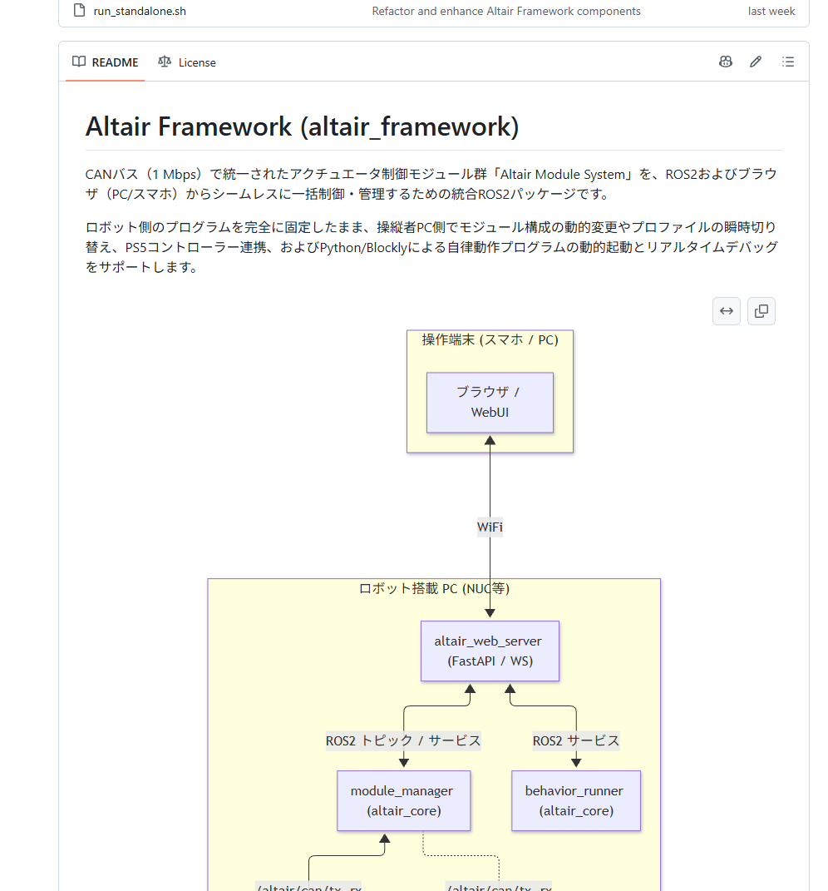

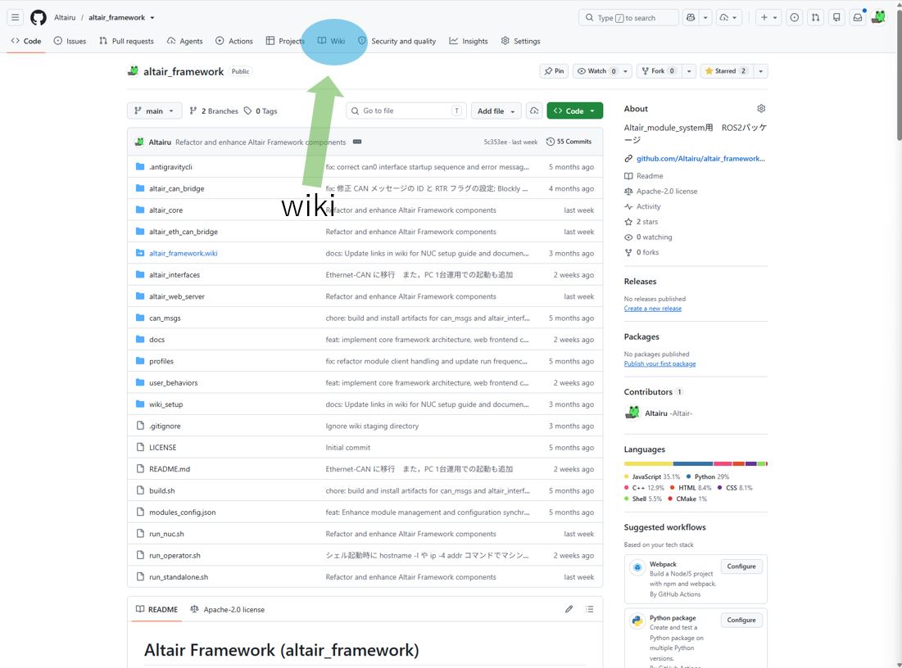

[altair_framework　wiki](https://github.com/Altairu/altair_framework/wiki)


??? Note
    著者:Shion Noguchi